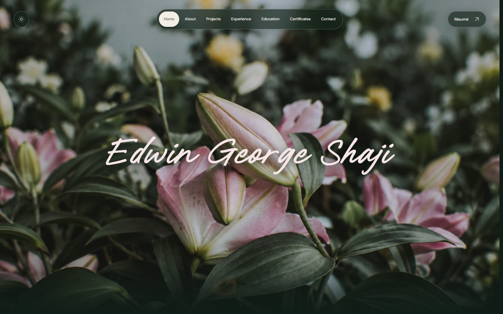

<p align="center">
  
</p>
<h1 align="center">Edwin George Shaji - Portfolio</h1>
<p align="center">
  My personal portfolio, built with HTML, CSS, vanilla JavaScript, and a Node.js static site generator.
  A home for my projects, experience, and explorations in software, AI, and quantum computing.
</p>
<p align="center">
  ♪ <a href="https://edwingeorgeshaji.com">Visit the website</a> ♪
</p>

<p align="center">
  
</p>

## 🛠 Set-up

Requires **Node.js 22 or newer**. From the repository root:

1. Enter the site directory and install dependencies.

   ```sh
   cd site
   npm ci
   ```

2. Start the development server.

   ```sh
   npm run dev
   ```

   Open [localhost:4173](http://127.0.0.1:4173). Changes to `src/` and `public/` rebuild automatically; refresh your browser to see them.

## 🚀 Build and run for production

Run these commands inside `site/`:

1. Generate and validate the static site.

   ```sh
   npm run build
   npm run check
   ```

2. Preview the production build locally.

   ```sh
   npm run preview
   ```

   Stop the development server first: both commands use port `4173`.

Deploy the contents of `site/dist/` to a static host. For Git-based hosting, set the root directory to `site`, the build command to `npm run build`, and the output directory to `dist`.

## 🎨 Colour codes

| Colour | Dark theme | Light theme |
| --- | --- | --- |
| Background |  `#101d17` |  `#e7eddf` |
| Surface |  `#192b21` |  `#d9e4d2` |
| Text |  `#e8ede2` |  `#263e2e` |
| Muted text |  `#a3b3a6` |  `#586f5d` |
| Accent |  `#dfb7c5` |  `#824b61` |
| Borders |  `#354b3c` |  `#b6c8af` |

For content editing and design guidance, see [site/README.md](site/README.md) and [site/DESIGN.md](site/DESIGN.md).
